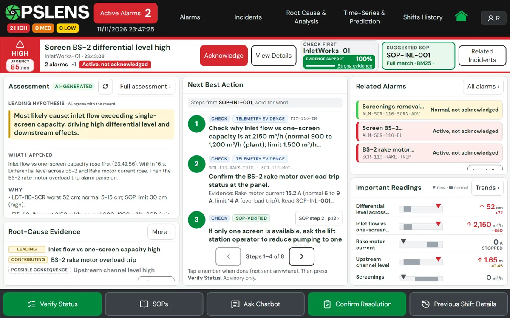

<!-- ======================================================================= --> <!-- nagavardhan987 · GitHub Profile README --> <!-- Theme: OpsLens dark + lime · accent #C6F432 · surface #0D1117 --> <!-- ======================================================================= --> 
    

   

 <!-- ---------------------------------------------------------------------- -->
 🙋‍♂️  About Me
python
class NagavardhanNeerumalla:
    def __init__(self):
        self.role      = "AI / ML Engineer in the making"
        self.education = "SRM Institute of Science and Technology"
        self.focus     = ["Machine Learning", "Backend Systems", "Industrial AI"]
        self.award     = "🥇 Winner — Schneider Electric HMI Hackathon 2026"
        self.mindset   = "Build things that are honest, evidence-based and genuinely useful."

    def say_hi(self):
        print("Thanks for stopping by — take a look at OpsLens below 👇")
<table> <tr> <td valign="top" width="50%">

🎓  Studying at SRM Institute of Science and Technology
🧠  I work at the intersection of AI, data & real-world operations
🏆  Built OpsLens — winner of the Schneider Electric HMI Hackathon 2026

</td> <td valign="top" width="50%">

🌱  Going deeper on ML, FastAPI backends & applied AI
💬  Ask me about Python, ML, FastAPI & AI copilots
⚡  Mindset — evidence first, never invent facts

</td> </tr> </table> <!-- ---------------------------------------------------------------------- -->
 🛠️  Tech Stack

       
 
      
 
      
 <!-- ---------------------------------------------------------------------- -->
 ⬡  Featured Project

   

<h1>OpsLens</h1>

An AI copilot that tells plant operators the story behind every alarm.

OpsLens reconstructs what moved first, ranks the likely cause on recorded evidence, pulls the exact SOP steps word-for-word, and has a local LLM explain it — with every line checked against the record. It is read-only and advisory: it never writes to the plant. On a lift-station trip it surfaces the leading cause (P-101 trip) with an evidence-support score and the first SOP step to run.

   

🟢  Live alarm · AI assessment · next best action · leading cause P-101 trip · evidence support 98%

  

 &nbsp;  &nbsp; 

  

FastAPI  ·  React  ·  Local LLM  ·  RAG  ·  OPC UA  ·  SQLite

 

Showcase

 <!-- ---------------------------------------------------------------------- -->
 📂  More Projects
Project	What it does	Built with
Agentic AI · Sales Analysis	An agentic pipeline that explores sales data and answers questions in plain language	Python LLM
RAG with Pinecone	Retrieval-augmented Q&A over your own documents, backed by a Pinecone vector store	TypeScript RAG
GAN for Image Generation	A generative adversarial network that synthesizes new images from noise	PyTorch Jupyter
Object Detection · YOLO	Real-time multi-object detection and localization with the YOLO family	YOLO Jupyter
Breast Cancer Prediction	A classifier that flags malignant vs. benign tumours from diagnostic features	scikit-learn
<!-- ---------------------------------------------------------------------- -->
 📊  GitHub Stats

      
 <!-- ---------------------------------------------------------------------- -->
 🤝  Connect

  

  

<i>“Build things that are honest, evidence-based and genuinely useful.”</i>

 

